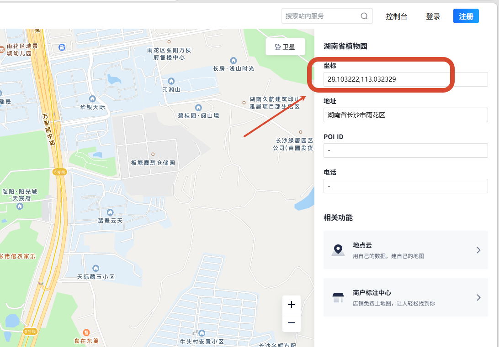
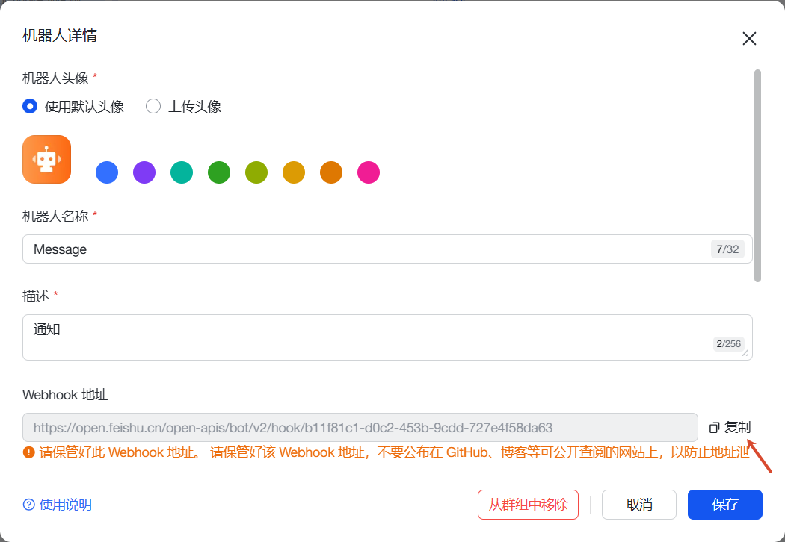
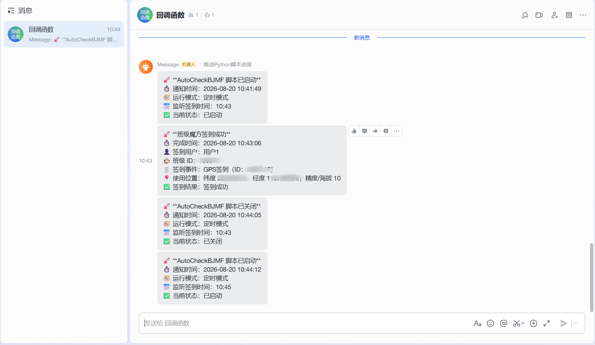

# AutoCheckBJMF

班级魔方 GPS 自动签到脚本。项目支持多账号、多班级、多定位点、定时触发、失败重试，并可通过 PushPlus 或飞书自定义机器人推送运行和签到结果通知。

> 本项目仅供学习交流使用。请遵守学校、课程和平台规则，使用本项目产生的后果由使用者自行承担。

## 功能特点

- **GPS 定位签到**：自动查找班级魔方页面中的 GPS 签到任务并提交定位信息。
- **多账号支持**：可以为多个账号依次执行签到，每个账号使用独立 Cookie。
- **多班级支持**：一个配置文件中可以保存多个班级 ID，脚本会按班级逐个处理。
- **多定位点支持**：可配置多个真实定位点，签到时遍历定位点并提交。
- **坐标微偏移**：提交前会对经纬度做小范围随机偏移，避免多个账号使用完全相同坐标。
- **定时执行**：支持每天多个时间区间，按固定秒数重复签到，并兼容旧时间点配置。
- **立即执行**：提供 `once.py`，可临时手动执行一次签到。
- **失败重试**：区间模式失败后由下一轮重新尝试；立即模式和旧时间点模式保留 30 秒、5 分钟的两次重试。
- **消息通知**：签到成功时可同时发送 PushPlus 和飞书通知；`main.py` 启动和关闭时也会通知当前监听的签到时间。

## 项目结构

| 路径 | 说明 |
|------|------|
| `make_config.py` | 配置向导，扫码登录、获取 Cookie、录入班级/坐标/定时/通知配置 |
| `main.py` | 定时运行入口，适合长期挂在电脑或服务器上 |
| `once.py` | 一次性运行入口，启动后立即执行一次签到 |
| `core/` | 核心模块，包含配置加载、签到、通知、定位、日志、倒计时等复用逻辑 |
| `config.json` | 运行配置，由 `make_config.py` 生成，已被 `.gitignore` 忽略 |

## 安装依赖

推荐使用 `uv`：

```bash
uv sync
```

也可以直接使用 `pip`：

```bash
pip install beautifulsoup4 drissionpage prompt-toolkit questionary requests rich schedule
```

项目要求 Python 3.11 或更高版本。

## 生成配置

配置过程需要打开浏览器扫码登录和选择地图坐标，建议在 Windows 桌面环境完成：

```bash
uv run python make_config.py
```

或：

```bash
python make_config.py
```

配置向导会生成 `config.json`，主要包含：

```json
{
    "classes": ["136341", "136342"],
    "locations": [
        {"lat": "22.766885", "lng": "108.451339", "acc": "10"}
    ],
    "cookies": [
        "remember_student_59ba36addc2b2f9401580f014c7f58ea4e30989d=xxxxx"
    ],
    "schedule_windows": [
        {"start": "08:00", "end": "08:30", "interval_seconds": 300},
        {"start": "12:00", "end": "12:20", "interval_seconds": 300}
    ],
    "pushplus": "",
    "feishu_webhook": "",
    "debug": false
}
```

### 1. 获取班级 ID 和 Cookie

配置向导会自动打开班级魔方微信扫码登录页面。

1. 使用微信扫码登录。
2. 登录成功后，脚本会从课程列表中提取班级 ID。
3. 脚本会监听请求并捕获 Cookie。
4. 如果有多个账号，按提示继续扫码添加。
5. 如果课程列表不完整，可以手动补充班级 ID。

Cookie 有有效期，过期后需要重新运行 `make_config.py` 刷新。

### 2. 配置签到位置

配置向导会打开腾讯地图坐标拾取工具。你可以直接复制地图中的坐标并粘贴到终端。



支持的输入格式示例：

```text
22.766885,108.451339
22.766885，108.451339
lat:22.766885 lng:108.451339
```

脚本按 `纬度,经度` 解析。坐标输入后还会要求输入 `acc`，不知道填什么时可以直接使用默认值 `10`。

### 3. 配置签到时间区间

配置向导第 3 步支持添加、修改、删除多个区间，分别输入开始时间、结束时间和步长（正整数秒，默认 `300`，即 5 分钟）。修改时留空保留原值，保存前会显示区间和步长汇总。

时间支持 `08:00`、`8:00`、`8：00`、`8 00`，统一保存为 `HH:MM`。区间保存在 `schedule_windows` 中：

```json
"schedule_windows": [
    {"start": "08:00", "end": "08:30", "interval_seconds": 300}
]
```

以上配置每天在 `08:00、08:05、08:10、08:15、08:20、08:25` 开始执行一轮，对所有班级、账号签到。

**访问频率与冷却风险：** 长时间、高频查询可能在签到发布前就触发服务器限流。已有日志显示，两个班级、一个账号每分钟执行一轮，约 20 分钟后返回了“119分钟完全后再访问该页面，冷却前访问一次会增加1分钟等待时间”。这不是已确认的固定次数阈值；限流可能在班级、账号或 IP 之间共享。每轮的查询数量还会随班级和账号数量增加。

新建区间默认每 **5 分钟（300 秒）** 查询一次，建议围绕预计签到时间缩短区间。五分钟并不保证不被限流，也可能错过持续时间不足五分钟的签到。已有配置中的显式步长仍会保留，需将 `interval_seconds` 改为 `300` 才会降低原配置的频率。

识别到上述冷却正文时，程序只发出“请求过于频繁”的警告，不打印错误详情、不进入失败重试、不宣告签到成功；本进程所有账号/班级请求暂停至服务器要求的等待时间结束，再额外等待一分钟余量，随后按原计划恢复。冷却状态暂存在内存中，重启会丢失本地等待记录，但不会解除服务器限制，因此不要用重启或同时运行多个脚本来尝试恢复访问。

- 固定使用北京时间（UTC+8），不受运行机器系统时区影响。旧时间点配置同样按北京时间执行，倒计时、通知和日志时间也统一为东八区。
- 包含开始时间，不包含结束时间。结束早于开始表示跨午夜，例如 `23:50 → 00:10`；起止相同不允许。
- 每次触发时刻按区间起点加步长计算。中途启动时等待下一个时刻，不补跑之前的任务。
- 所有签到串行执行。单轮耗时超过步长时跳过已错过的时刻，不并发、不排队补跑。
- 到达区间终点后不再启动新一轮，已经开始的一轮允许完成。
- 区间重叠时，同一触发时刻只执行一轮。成功后仍继续按计划检查后续签到任务。
- 本次运行中按“账号、班级、签到任务 ID”记住已完成任务，后续轮询跳过重复提交，新的任务 ID 仍正常签到。任务详情提示“我已签到过啦”（兼容“我已经签到过啦”）时按已完成处理，不报错重试、不重复发送成功通知。课程列表中的已签到卡片（`punch-card--success`、`punch-status` 为“已签到”）单独提示并跳过，同页未完成任务继续处理。已签到卡片可能没有任务 ID，不据此推断整个班级已完成。记录保存在内存中，重启后通过服务器响应重新识别。
- 区间模式不执行原来的 30 秒、5 分钟等待重试，失败后在下一次触发时重新尝试。

**旧配置兼容：** 没有 `schedule_windows` 字段时，继续使用原有 `scheduletimes` 时间点。向导检测到旧配置时，可选择保留或切换为区间模式；切换时需要录入区间终点和步长。存在 `schedule_windows` 时，旧时间点不再生效。

`schedule_windows` 为空列表时，`main.py` 启动后立即执行一次；旧配置的 `scheduletimes` 为空时也保持这一行为。`once.py` 始终立即执行一次并保留内部重试。

### 4. 配置消息通知

通知是可选项。PushPlus 和飞书可以同时配置；都配置时，签到成功和 `main.py` 启动/关闭通知会两个渠道都发送。

#### PushPlus

PushPlus 只需要在配置向导中填入 Token。Token 获取、通道绑定、消息限制等内容建议直接参考 [PushPlus 官方文档](https://www.pushplus.plus/doc/)。

#### 飞书 Webhook

在飞书群中添加自定义机器人，复制机器人 Webhook 地址，填入配置向导的 `feishu_webhook`。



签到成功后的飞书通知会包含用户、班级、签到事件、使用位置和签到结果。



## 运行项目

### 定时自动签到

```bash
uv run python main.py
```

或：

```bash
python main.py
```

`main.py` 会读取区间配置（或兼容旧时间点配置），并在终端显示下一次实际执行时刻和倒计时。按 `Ctrl+C` 可以停止脚本。

`main.py` 会在以下场景发送通知：

- 脚本启动
- 脚本关闭
- 签到成功

### 立即签到

```bash
uv run python once.py
```

或：

```bash
python once.py
```

`once.py` 启动后立即执行一次签到，不发送启动/关闭通知，只在签到成功时发送通知。

## 配合采集签到前后报文

`capture_signin.py` 读取现有 `config.json`。先运行配置检查（不联网）：

```bash
python capture_signin.py
```

停止其他签到进程，确认冷却结束、测试签到任务已发布后，指定班级执行一次：

```bash
python capture_signin.py --run --class-id 111026
```

默认选账号 1 和定位点 1，可用 `--account`、`--location` 修改。存在多个 GPS 任务时需用 `--task-id` 指定目标。执行顺序是课程列表 GET → 任务页面 GET → 一次签到 POST → 任务页面 GET → 课程列表 GET。POST 使用所选配置中的坐标，会真实提交签到；不发送通知、不轮询、不重复提交。服务器跳转也逐条记录，冷却或异常时立即停止。

报文保存在 `captures/时间_随机编号/`：每条请求/响应的 JSON、完整解压后的响应 HTML、前后页面差异 `course.diff` / `task.diff` 和 `summary.json`。Cookie 与认证头脱敏，页面中的个人信息仍可能保留，文件不纳入 Git。采集完成只代表报文齐全，签到结果和任务完成标记需要根据实际响应分析后再对齐代码。

## 服务器部署建议

如果要部署到云服务器，建议先在 Windows 桌面环境运行 `make_config.py` 生成 `config.json`，再把配置文件上传到服务器。

使用 pm2 托管示例：

```js
module.exports = {
  apps: [{
    name: "AutoCheckBJMF",
    script: "main.py",
    interpreter: "python3",
    cwd: "/path/to/AutoCheckBJMF",
    restart_delay: 5000,
    max_restarts: 10,
    log_date_format: "YYYY-MM-DD HH:mm:ss"
  }]
};
```

启动：

```bash
pm2 start ecosystem.config.js
pm2 logs AutoCheckBJMF
pm2 save
```

云服务器通常没有图形界面，不适合运行 `make_config.py`。Cookie 过期后，需要回到 Windows 桌面环境重新扫码更新配置。

## 常见问题

**Q：为什么没有生成 `config.json`？**  
A：请确认配置向导最后选择了保存。当前版本默认保存，只有明确选择不保存才会跳过导出。

**Q：签到失败最常见的原因是什么？**  
A：通常是 Cookie 过期、网络异常、班级 ID 错误，或者页面结构发生变化。

**Q：第一次签到成功，后续轮次提示“登录状态异常”，但 Cookie 没变？**

A：旧版每次请求只发送配置中的 `remember_student`，不会保留服务器返回的会话 Cookie；同时把“标题含出错”或“缺少标题”的响应统称为登录异常，无法区分登录失效、限流或其他业务错误。当前版本按账号维护独立会话，在课程查询、签到提交、跨班级和后续定时轮次间保留服务器更新的 Cookie。仅凭 HTTP 200 或重启后恢复，仍不能确定具体原因，需要查看失败响应。

**Q：如何查看完整错误信息和时间？**

A：签到请求失败时，终端和项目目录中的 `AutoCheckBJMF.log` 都会记录班级/账号、请求 URL、HTTP 状态码、跳转链、请求/响应头、完整响应正文；网络异常还会记录完整异常堆栈。时间固定为北京时间（UTC+8），精确到毫秒，例如 `2026-10-20 08:49:00.123+08:00`。关闭 `debug` 也会记录错误，开启后增加运行信息。Cookie、认证请求头及已识别的凭据值会脱敏；页面仍可能包含姓名等个人信息，分享日志前请检查。日志单文件上限为 10 MiB，保留 3 份轮转备份。

**Q：PushPlus 和飞书能同时发吗？**  
A：可以。`pushplus` 和 `feishu_webhook` 都配置时，两个渠道都会发送。

**Q：`once.py` 会发送启动和关闭通知吗？**  
A：不会。`once.py` 只在签到成功时通知；启动和关闭通知只属于长期运行的 `main.py`。

## 免责声明

本项目仅供学习交流使用，请勿用于作弊或违反平台规则的行为。使用本项目产生的一切后果由使用者自行承担。

## Star History

<a href="https://www.star-history.com/?repos=moeus%2Fautocheckbjmf&type=date&legend=top-left">
 <picture>
   <source media="(prefers-color-scheme: dark)" srcset="https://api.star-history.com/chart?repos=moeus/autocheckbjmf&type=date&theme=dark&legend=top-left" />
   <source media="(prefers-color-scheme: light)" srcset="https://api.star-history.com/chart?repos=moeus/autocheckbjmf&type=date&legend=top-left" />
   
 </picture>
</a>
